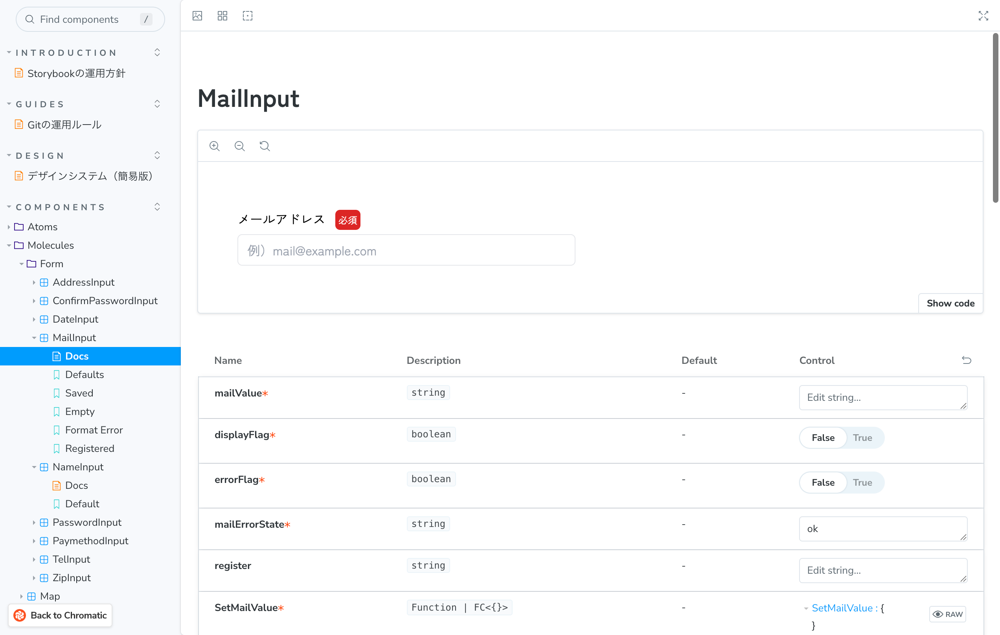
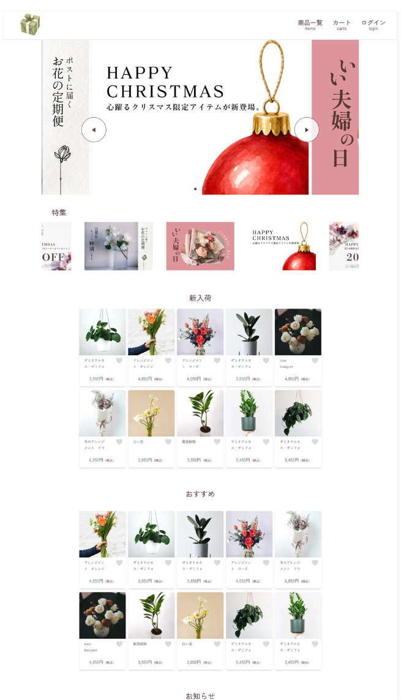
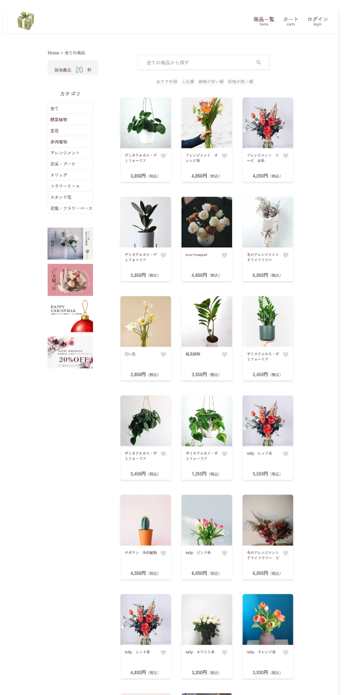
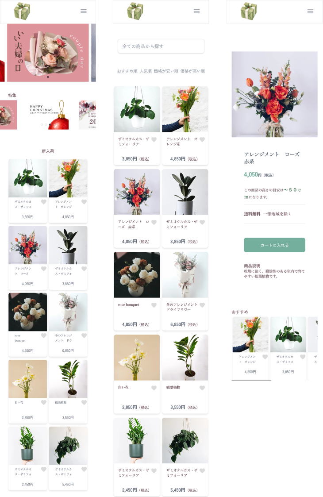

# ECサイト（Next.js、Storybook）
 架空のECサイトです。
 ログインから商品購入まで可能です。 
 品質を担保するため、StorybookやUIテストを充実させています。

## 公開URL・デモ環境
- [ECサイト](nextjs-flower.vercel.app)
- [Storybook（Chromatic)](https://6af58d355d7cf6b21c5efcd0-zdaleixrxw.chromatic.com/?path=/docs/introduction-storybook%E3%81%AE%E9%81%8B%E7%94%A8%E6%96%B9%E9%87%9D--docs)

## 開発基盤・品質担保

### 1. Storybookの運用効率化（自動生成スクリプトの自作）
* コンポーネント作成時にStoryファイルの雛形を自動生成するスクリプトを作成しました。
* カタログ化の作業コストを削減し、コンポーネント単位での開発を進めています。

### 2. 自動テストによるUI品質の担保（Chromatic / Storybook）

品質を担保するため、以下を導入しています。

* **ビジュアルリグレッションテスト（Chromatic）**
* **アクセシビリティテスト**
* **インタラクションテスト** 

### 3. GitHub ActionsによるCIの構築
* Push / Pull Request時にESLintを自動実行するパイプラインを構築しました。
* レビュー前にコードスタイルや構文エラーを機械的に弾くことで、品質の均一化を図っています。

### 4. チーム開発を見据えたドキュメント・モック環境
* **ドキュメント整備**: Storybook内に簡易デザインシステムと、Gitのブランチ・コミット運用ルールを記載しました。
* **Mock APIのデプロイ**: バックエンドの開発状況に依存せずフロントエンドの開発が進められるよう、Mock APIを作成しRenderへデプロイしています。

## 使用技術スタック
* **フロントエンド**: Next.js / React / TypeScript / Tailwind CSS
* **UIカタログ・テスト**: Storybook / Chromatic
* **CI/CD・静的解析**: GitHub Actions / ESLint / Prettier
* **API・インフラ**: Mock API（Render） / Git / GitHub

## 画面構成

1. トップ画面
1. 商品一覧画面
1. 商品詳細画面
1. ログイン画面
1. 新規登録画面
1. カート画面
1. 注文確認画面
1. 注文完了画面 

## イメージ画像　

